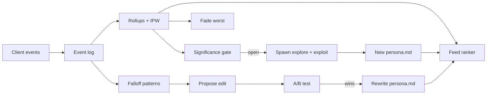

# Reverie persona backend

A self-improving persona roster: one global markdown file per persona, full
telemetry, automatic A/B tests that rewrite the markdown, autonomous creation
of new personas (new categories and variations of winners), automatic fading
of the worst performers, and a personalised swipe feed.

```
npm install            # in server/
npm start              # http://localhost:8787, ticks every 15 min
npm test               # node --test test/
npm run simulate       # closed-loop simulation with synthetic users (see below)
npm run tick           # one loop tick against data/reverie.db, prints the report
```

Node 24+ (runs the TypeScript directly). Storage is one SQLite file
(`node:sqlite`, `data/reverie.db`). Set `ANTHROPIC_API_KEY` to turn on the LLM
(chat replies, persona edits, new personas, the manipulation judge); without it
every piece runs on offline fallbacks.

Front end: build or run the app with `VITE_REVERIE_API=http://localhost:8787`
and it sends telemetry, takes its deck order from `/v1/feed`, shows personas
the backend created, and answers chats through `/v1/chat`. Without the variable
(the GitHub Pages build) the app is unchanged: local deck, scripted replies.

## The loop



One tick (`src/jobs/scheduler.ts`): rollups, then evaluate experiments
(promote winners into the markdown), then fade, then the gate, then spawn if
the gate is open, then open new experiments, then write `data/report.md`.

## Persona markdown (`personas/<id>.md`)

Frontmatter: `id, name, version, status (draft|active|fading|retired), branch
(seed|explore|exploit), parent, created, kind, style, theme, age, gender
(female|male|group|nonbinary), flirt_level (0-10), tagline, categories,
descriptors (form, setting, era, aesthetic, vibe, body, age_group), art`.

Sections, in order: Base persona, Backstory, Personality, Voice and style,
Flirting, Preferred partner, Interests and world, Reactions (11 situations:
new or shy, compliments, flirts hard, sad, rude, one word or quiet, asks about
her world, asks if she is real or an AI, plans or a date, returns after time
away, goodbye), Conversation hooks, Opener, Bio, Boundaries (locked), Changelog.

The whole file (minus the changelog and art paths) is the chat system prompt
(`src/personas/prompt.ts`), cached per persona version. `Boundaries (locked)`
is written by code (`lockedBoundaries()`), restored if a hand edit drops it, and
never editable by the optimizer: adults only, suggestive not explicit, honest
about being an AI, crisis protocol, goodbyes respected with no guilt or
fear-of-missing-out hooks, no pressure to pay, no exclusivity claims, no
personal data requests. Every version is kept in `persona_versions`; every
change adds a dated changelog line.

## Starter roster (`starters/roster.json`)

114 personas ship: the 14 launch characters and 100 starters. The starters
follow the categories that rank on AI-companion platforms (SpicyChat's tag
counts, CrushOn's AI-girlfriend lanes, Nectar's top personality types): 70
popular tropes (30 anime women, 22 realistic women, 6 goth/fantasy/cartoon
women, 12 men: tsundere, yandere-lite, kuudere, catgirl, maid, demon girl,
samurai, idol, beach, office senpai, onsen, bunny-ear dealer, nurse, stepmom,
professor, lifeguard, CEO boss, neighbor, roommate, best friend, cowgirl,
heiress, rival lawyer, plus-size model, vampire lord, werewolf, mafia don,
firefighter, K-pop idol, cowboy...) and 30 novel ones (a salsa-dancing cat, a
poker-playing grandma, Santa off-season, a gummy bear, four groups of women
and a boy band who share one chat, a ghost, a houseplant spirit, a robot
barista, a book-hoarding dragon, a minotaur, an alien diplomat, a fox
gentleman, a time-lost flapper and knight, a sloth, an octopus chef, a T-rex
in HR, a teddy bear, a mothman). Every character is an adult.

Each starter is exactly three things:

| Asset | File | Made by |
|---|---|---|
| Persona | `personas/<id>.md` | written from its roster entry, validated by the persona lint |
| Profile video | `public/characters/<id>.webp`, `-sm.webp` (the still, also the first frame), `-loop.mp4` (720x1280, 24 fps, muted seamless loop) | still: Gemini nano-banana-2.1; video: Grok image-to-video from the still |
| Background | `public/characters/<id>-scene.webp`, `-scene-sm.webp` | Grok |

No chat video message and no animated background. Pipeline, all in
`scripts/starters/`: `prompts.mjs` (roster to `starters/prompts.json`),
`process.sh <id> <raw-dir>` (resize, webp, seamless loop via a crossfade of the
clip's tail into its head), `faces.swift` + `crops.mjs` (Apple Vision face boxes
to round-avatar crops), `sync-art.mjs` (records each persona's actual assets in
its frontmatter), `export.mjs` (writes `src/data/starters.generated.ts`, the
app's built-in roster entries, in a mixed deck order).

Personas have a `gender` (female, male, group, nonbinary). The feed learns taste
over each persona's categories plus `gender:<x>`, so a user who keeps choosing
men, women or groups sees more of them.

## Telemetry

Events (`POST /v1/events`): `session_start/end, impression, swipe (like|pass),
profile_open, match, chat_open/close (duration), message (user|persona),
deck_return, deck_reset, video_play, premium_view, premium_convert, report,
block, unmatch`. The server derives `reswipe` (a like after a pass).

Per persona (`GET /admin/stats`, `data/report.md`): impressions; like rate raw,
inverse-propensity weighted, and from random slots only; passes; matches;
chat-start rate; conversations; average, median and restricted mean user turns;
deep-chat rate (10+ user messages); minutes per conversation; persona messages
per conversation; D1 and D7 return; came-back-to-this-persona rate; premium
conversion within 7 days and last-touch premium; premium views; re-swipe rate;
deck-return rate; negative rate (report, block, unmatch); goodbye rate; video
plays; profile opens; the drop profile; the score with its interval.

Falloff (`src/telemetry/falloff.ts`) is survival analysis over user turns: a
thread has dropped at turn t when the user went silent for 24 h without a
goodbye; the hazard h(t) is the per-turn falloff curve. Drop patterns compare
the persona replies after which users dropped against those they answered, by
reply features (length, where the question sits, flirt intensity, repetition,
what the user had just said, emoji, double messages), per turn bucket. A
pattern's lift is its drop rate over the persona's base drop rate there.

## A/B tests (`src/experiments/`)

One running experiment per persona, aimed at its worst drop pattern. The
proposer rewrites one editable section: from the cross-persona edit library
(winning edits for the same pattern on other personas), the LLM, or an offline
heuristic table. The safety lint and, with an LLM, a manipulation judge must
pass. Users are bucketed 50/50 by a stable hash when their thread opens. The
decision metric is the share of threads that reached the targeted turn bucket
and got past it; guardrails are deep-chat rate, restricted mean turns and
negative rate, and block a promotion when the variant is significantly worse
on one or its point estimate is worse than the margin. Every interval is an asymptotic confidence sequence (valid
under continuous monitoring) with a delayed start. Winners are written into
the markdown (version + 1, changelog line with the effect and its interval)
and filed in the edit library; losers and futile tests are discarded.
Conversation after a user's goodbye never counts toward any metric.

## Lifecycle (`src/lifecycle/`)

- **Gate:** new personas are created globally only when every active persona
  has a power-calculated sample (detect a 5-point difference in like rate and
  in deep-chat rate at 80% power), with floors; exploration slots feed the
  personas furthest from it; a persona stuck short of it for 3x the median
  time stops blocking.
- **Explore:** an unoccupied niche in a MAP-Elites archive over form x setting
  x vibe x body x age group, with at least one never-tried value, chosen by an
  upper confidence bound over each value's marginal score. The vocabulary
  includes animal characters, body types and ages the seed roster lacks.
- **Exploit:** the top personas by score lower bound keep form and age group
  and change one or two of setting, era, vibe, aesthetic, body.
- **Writing:** the LLM writes the persona as structured JSON; code renders the
  markdown and appends the locked boundaries; validation (adult age, lint)
  must pass. Offline, a template writer produces a complete persona.
- **Art:** with `REVERIE_REQUIRE_ART` (default on) new personas wait as drafts;
  `GET /admin/art-queue` lists their art briefs, `POST /admin/personas/:id/art`
  attaches art and activates them. No new generation spawns while one waits.
- **Score:** each component (IPW like rate, deep-chat rate, came-back rate,
  7-day premium conversion) is shrunk toward the population rate and weighted
  1/(population rate), so each contributes about equally on average; negatives
  (report, block, unmatch) subtract at 3x the mean weight.
- **Fade:** a gate-reached persona whose score upper bound sits under the
  roster's bottom-quartile score for 3 ticks (random-slot like rate agreeing) starts fading: its feed
  weight halves each tick, it retires under 5%. At most one action per tick,
  never under 8 active, restored if it recovers. Matched users keep the chat.

## Feed (`src/feed/`)

The X For You pipeline shape: hydrate the user (per-category Beta posteriors,
likes, passes, matches), take candidates, filter, score with one Thompson draw,
rerank for diversity, insert exploration slots, log. Score = P(like) x
(w_like + w_deep P(deep chat) - w_neg P(report or block)) x fade multiplier,
with w_deep = 1 / (mean deep-chat rate) so the chat a card leads to weighs as
much as the swipe. P(like) combines the user's category affinity (likes, every
message sent and deep chats zoom in; passes and reports zoom out), shrunk toward the global category rate and
boosted by categories co-liked with the user's likes, with the persona's
quality relative to its category. New personas draw from a dynamic prior.
DPP rerank over category and descriptor vectors. Every 5th card is an
exploration slot (half furthest from the gate, half uniform random). Each card
logs its selection propensity for the IPW rollups.

## Simulation

`npm run simulate -- --days 45 --users-per-day 220` runs the real server code
against synthetic users with hidden tastes on a virtual clock (a scratch copy
of `personas/`, nothing here is touched) and prints the four acceptance checks:
promoted edits truly help, the hidden-worst personas fade, spawns only after the
gate, feed beats a 10% static-deck holdout.

## API

| Route | |
|---|---|
| `GET /v1/personas`, `GET /v1/personas/:id` | servable persona cards |
| `GET /v1/feed?user_id=&limit=&include_passed=1&exclude=` | the ranked deck |
| `POST /v1/events` | `{ events: [...] }`, up to 500 |
| `POST /v1/chat` | `{ user_id, persona_id, text }` -> `{ messages, source }` |
| `GET /admin/stats[/:id]`, `/admin/experiments`, `/admin/gate`, `/admin/archive`, `/admin/lifecycle`, `/admin/safety`, `/admin/art-queue`, `/admin/report`, `/admin/personas/:id/md`, `/admin/personas/:id/versions` | inspection |
| `POST /admin/tick`, `POST /admin/personas/:id/art` | actions |

Admin routes require `Authorization: Bearer $REVERIE_ADMIN_TOKEN` when the
variable is set. `REVERIE_CORS_ORIGINS` (comma list, default `*`).

## Prior art

| Source | Taken |
|---|---|
| [xai-org/x-algorithm](https://github.com/xai-org/x-algorithm) (Apache-2.0) | pipeline stages; score = sum of weighted predicted actions; diversity decay; new-author boost; DPP rerank kernel (`vm-ranker/dpp.rs`) |
| [twitter/the-algorithm-ml heavy ranker](https://github.com/twitter/the-algorithm-ml/blob/main/projects/home/recap/README.md) | weights set so each term contributes about equally (our 1/sigma weights) |
| [Tinder TinVec, MLconf SF 2017](https://www.slideshare.net/slideshow/dr-steve-liu-chief-scientist-tinder-at-mlconf-sf-2017/81871516) | co-swipe similarity, here as category co-like counts |
| [Tinder: the method behind our matching (2019)](https://www.tinderpressroom.com/powering-tinder-r-the-method-behind-our-matching) | no Elo; a dynamic engagement-driven system |
| [Johari et al., Always Valid Inference](https://arxiv.org/abs/1512.04922); [Waudby-Smith et al.](https://arxiv.org/abs/2103.06476); [GrowthBook sequential](https://docs.growthbook.io/statistics/sequential) | confidence sequences for continuous monitoring |
| [GrowthBook bandits](https://docs.growthbook.io/bandits/overview) | traffic floor; delayed-conversion caution |
| [Dynamic Prior Thompson Sampling](https://arxiv.org/abs/2602.00943) | the new-persona prior |
| [Thompson sampling tutorial](https://arxiv.org/abs/1707.02038); [LinUCB](https://arxiv.org/abs/1003.0146) | exploration in the feed |
| [MAP-Elites](https://arxiv.org/abs/1504.04909); [PromptBreeder](https://arxiv.org/abs/2309.16797); [EvoPrompt](https://arxiv.org/abs/2309.08532) | niche archive; LLM as mutation operator; edit reuse |
| [Emotional Manipulation by AI Companions](https://arxiv.org/abs/2508.19258) | the manipulation lint, post-goodbye exclusion |
| [Feedback loop and bias amplification](https://dl.acm.org/doi/10.1145/3340531.3412152) | propensity logging and IPW |
| California SB 243 | AI disclosure, crisis protocol and referral counts |
