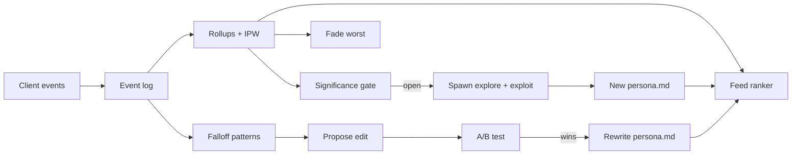

# Reverie persona backend

A self-improving persona roster: one global markdown file per persona, full
telemetry, automatic A/B tests that rewrite the markdown, autonomous creation
of new personas (new categories and variations of winners), automatic fading
of the worst performers, and a personalised swipe feed.

```
npm install            # in server/
npm start              # http://localhost:8787, ticks every 15 min
npm test               # node --test test/
npm run simulate       # closed-loop simulation with synthetic users (see below)
npm run bench:feed     # the ranker alone against hidden-taste users, scored by true like probability
npm run tick           # one loop tick against data/reverie.db, prints the report
```

Node 24+ (runs the TypeScript directly). Storage is one SQLite file
(`node:sqlite`, `data/reverie.db`). Set `ANTHROPIC_API_KEY` to turn on the LLM
(chat replies, persona edits, new personas, the manipulation judge); without it
every piece runs on offline fallbacks.

Front end: build or run the app with `VITE_REVERIE_API=http://localhost:8787`
and it sends telemetry, takes its deck order from `/v1/feed`, shows personas
the backend created, and answers chats through `/v1/chat`. Without the variable
(the GitHub Pages build) the app is unchanged: local deck, scripted replies.

## The loop



One tick (`src/jobs/scheduler.ts`): rollups, then evaluate experiments
(promote winners into the markdown), then fade, then the gate, then spawn if
the gate is open, then open new experiments, then write `data/report.md`.

## Persona markdown (`personas/<id>.md`)

Frontmatter: `id, name, version, status (draft|active|fading|retired), branch
(seed|explore|exploit), parent, created, kind, style, theme, age, gender
(female|male|group|nonbinary), flirt_level (0-10), tagline, categories,
descriptors (form, setting, era, aesthetic, vibe, body, age_group), art`.

Sections, in order: Base persona, Backstory, Personality, Voice and style,
Flirting, Preferred partner, Interests and world, Reactions (11 situations:
new or shy, compliments, flirts hard, sad, rude, one word or quiet, asks about
her world, asks if she is real or an AI, plans or a date, returns after time
away, goodbye), Conversation hooks, Opener, Bio, Boundaries (locked), Changelog.

The whole file (minus the changelog and art paths) is the chat system prompt
(`src/personas/prompt.ts`), cached per persona version. `Boundaries (locked)`
is written by code (`lockedBoundaries()`), restored if a hand edit drops it, and
never editable by the optimizer: adults only, suggestive not explicit, honest
about being an AI, crisis protocol, goodbyes respected with no guilt or
fear-of-missing-out hooks, no pressure to pay, no exclusivity claims, no
personal data requests. Every version is kept in `persona_versions`; every
change adds a dated changelog line.

## Starter roster (`starters/roster.json`)

154 personas ship: the 14 launch characters and 140 starters. The starters
follow the categories that rank on AI-companion platforms (SpicyChat's tag
counts, CrushOn's AI-girlfriend lanes, Nectar's top personality types): 70
popular tropes (30 anime women, 22 realistic women, 6 goth/fantasy/cartoon
women, 12 men: tsundere, yandere-lite, kuudere, catgirl, maid, demon girl,
samurai, idol, beach, office senpai, onsen, bunny-ear dealer, nurse, stepmom,
professor, lifeguard, CEO boss, neighbor, roommate, best friend, cowgirl,
heiress, rival lawyer, plus-size model, vampire lord, werewolf, mafia don,
firefighter, K-pop idol, cowboy...) and 30 novel ones (a salsa-dancing cat, a
poker-playing grandma, Santa off-season, a gummy bear, four groups of women
and a boy band who share one chat, a ghost, a houseplant spirit, a robot
barista, a book-hoarding dragon, a minotaur, an alien diplomat, a fox
gentleman, a time-lost flapper and knight, a sloth, an octopus chef, a T-rex
in HR, a teddy bear, a mothman), plus 40 "spicy" ones (`group: "spicy"`, flirt
level 8 to 10) built on the role-play tropes that top adult sites' 2025 search
data (Pornhub's Year in Review: job role play such as cop +54%, soldier +41%,
boss +175%, plumber +67%, driver +144%, chef +39% and professor +33%; MILF as
the #2 search with cougar, GILF and mature rising; hentai #1; cosplay; femboy
entering the top 10): a police officer, an army sergeant, an editor-in-chief
boss, a fire captain, an airline pilot, a head chef, a plumber, a chauffeur, a
divorced neighbor, a cougar, a former showgirl, a superyacht stewardess, an
anime traffic cop, a very curvy landlady, a dark elf, a cosplayer, a succubus,
a race queen, a shrine maiden, a bodyguard, a host, a femboy streamer, a couple
next door and three Vegas bridesmaids. Their art is glamorous and
form-fitting but fully clothed, and their chat is heavy on innuendo but still
bound by the locked Boundaries: suggestive, never explicit. Every character is
an adult.

Each starter is exactly three things:

| Asset | File | Made by |
|---|---|---|
| Persona | `personas/<id>.md` | written from its roster entry, validated by the persona lint |
| Profile video | `public/characters/<id>.webp`, `-sm.webp` (the still, also the first frame), `-loop.mp4` (720x1280, 24 fps, muted seamless loop) | still: Gemini nano-banana-2.1; video: Grok image-to-video from the still |
| Background | `public/characters/<id>-scene.webp`, `-scene-sm.webp` | Grok |

No chat video message and no animated background. Pipeline, all in
`scripts/starters/`: `prompts.mjs` (roster to `starters/prompts.json`),
`process.sh <id> <raw-dir>` (resize, webp, seamless loop via a crossfade of the
clip's tail into its head), `faces.swift` + `crops.mjs` (Apple Vision face boxes
to round-avatar crops), `sync-art.mjs` (records each persona's actual assets in
its frontmatter), `export.mjs` (writes `src/data/starters.generated.ts`, the
app's built-in roster entries, in a mixed deck order).

Personas have a `gender` (female, male, group, nonbinary). The feed learns taste
over each persona's categories plus `gender:<x>`, so a user who keeps choosing
men, women or groups sees more of them.

## Automatic art (optional, default off)

Personas the server invents start as drafts with no art. With
`REVERIE_AUTO_ART=1` and both API keys, each tick (and `POST /admin/art/run`)
takes the non-seed drafts with no `art.portrait` and, per persona (`src/art/`):

1. draws the portrait (Gemini `gemini-nano-banana-2.1`, 9:16, 2K) and the
   background plate (same model, no people),
2. animates the portrait into a 6 s, 720p, silent profile video (xAI
   `grok-imagine-video`, the portrait as first frame, async job, polled),
3. post-processes with `magick`/`ffmpeg`/`ffprobe` exactly like
   `scripts/starters/process.sh` into the same five files the starters have,
   `<id>.webp`, `<id>-sm.webp`, `<id>-scene.webp`, `<id>-scene-sm.webp`,
   `<id>-loop.mp4` (no other assets), in `REVERIE_ART_DIR` (default the repo's
   `public/characters`; built in a staging folder and moved in only when all
   five exist),
4. sets `art` to `{ portrait, portraitSm, loop, scene, sceneSm }` with
   `/characters/<id>...` paths and activates the persona (the same code path as
   `POST /admin/personas/:id/art`, `src/art/attach.ts`).

Prompts come from `src/art/prompts.ts`, shared with `scripts/starters/prompts.mjs`
(running that script still reproduces `starters/prompts.json` byte for byte):
always an adult, fully clothed, non-explicit, no text or logos. They are built
from the persona's style, name, kind, age, gender, descriptors and `artBrief`.
Retries send the identical prompts; nothing is ever loosened.

| Env var | Default | |
|---|---|---|
| `REVERIE_AUTO_ART` | off | `1` turns it on. Needs both keys below; without them it logs once and skips |
| `GEMINI_API_KEY` | | stills and backgrounds |
| `XAI_API_KEY` | | profile video |
| `REVERIE_ART_DAILY_USD` | `5` | cap on estimated spend per UTC day |
| `REVERIE_ART_PERSONA_USD` | `0.414` | estimate checked against the cap before each persona |
| `REVERIE_ART_MAX_PER_TICK` | `2` | personas handled per tick or per `POST /admin/art/run` |
| `REVERIE_ART_DIR` | `<repo>/public/characters` | where the five files land |

Cost per persona is about **$0.41**: two images at about $0.057 and 6 s of
video at $0.05/s (list prices read 2026-11-05; Gemini's page shows $0.0504 for a
2K image plus tokens, xAI `grok-imagine-video` is $0.050/s). Those prices,
the 2K size, models and attempt limit are config values (`art` in
`src/config.ts`). The default $5 cap is about 12 personas a day; at 4 new
personas a generation that is plenty. Every attempt is a row in the `art_spend`
table (persona, time, estimated cost, `pending|ok|failed|refused`, error), the
cost is added as each stage is paid for (a video job the provider never
accepted is not charged), and a persona is refused when today's UTC total plus
the per-persona estimate would pass the cap; the next UTC day starts at zero.
`GET /admin/art-queue` shows `auto`: enabled, missing keys, spent and remaining
today, the waiting ids and the 20 latest attempts.

A provider error or moderation refusal marks the attempt failed and leaves the
persona a draft; the next tick tries again, up to 3 attempts, then one
`art_gave_up` row lands in `lifecycle_log` and the persona waits for a human
(`POST /admin/personas/:id/art`). No new generation spawns while a non-seed
draft is still waiting for art, but a draft the job gave up on no longer
counts, so one stubborn refusal cannot pause the loop. `POST /admin/art/run` takes an optional `{ "id" }`
and, like `/admin/tick`, returns when the work is done (a video takes minutes).

Docs the calls follow: Gemini Interactions API
(<https://ai.google.dev/gemini-api/docs/image-generation>,
<https://ai.google.dev/api/interactions-api>) and xAI video
(<https://docs.x.ai/developers/model-capabilities/video/generation>,
<https://docs.x.ai/developers/model-capabilities/video/image-to-video>). Tests
(`test/art.test.ts`) use a fake provider and a fake `fetch`; live calls have not
been run without real keys.

## Telemetry

Events (`POST /v1/events`): `session_start/end, impression, swipe (like|pass),
profile_open, match, chat_open/close (duration), message (user|persona),
deck_return, deck_reset, video_play, premium_view, premium_convert, report,
block, unmatch`. The server derives `reswipe` (a like after a pass).

Per persona (`GET /admin/stats`, `data/report.md`): impressions; like rate raw,
inverse-propensity weighted, and from random slots only; passes; matches;
chat-start rate; conversations; average, median and restricted mean user turns;
deep-chat rate (10+ user messages); minutes per conversation; persona messages
per conversation; D1 and D7 return; came-back-to-this-persona rate; premium
conversion within 7 days and last-touch premium; premium views; re-swipe rate;
deck-return rate; negative rate (report, block, unmatch); goodbye rate; video
plays; profile opens; the drop profile; the score with its interval.

Falloff (`src/telemetry/falloff.ts`) is survival analysis over user turns: a
thread has dropped at turn t when the user went silent for 24 h without a
goodbye; the hazard h(t) is the per-turn falloff curve. Drop patterns compare
the persona replies after which users dropped against those they answered, by
reply features (length, where the question sits, flirt intensity, repetition,
what the user had just said, emoji, double messages), per turn bucket. A
pattern's lift is its drop rate over the persona's base drop rate there.

## A/B tests (`src/experiments/`)

Tests open only when the server's LLM writes the replies
(`experiments.requireServedReplies`, default on): with no LLM the app shows
its scripted replies, both arms would be identical, and a "win" could only be
noise. One running experiment per persona, aimed at its worst drop pattern. The
proposer rewrites one editable section: from the cross-persona edit library
(winning edits for the same pattern on other personas), the LLM, or an offline
heuristic table. The safety lint and, with an LLM, a manipulation judge must
pass. Users are bucketed 50/50 by a stable hash when their thread opens. The
decision metric is the share of threads that reached the targeted turn bucket
and got past it; guardrails are deep-chat rate, restricted mean turns and
negative rate, and block a promotion when the variant is significantly worse
on one or its point estimate is worse than the margin. Every interval is an asymptotic confidence sequence (valid
under continuous monitoring) with a delayed start. Because tests keep coming,
the target is tested at a per-test level from online false-discovery-rate
control (LORD++, asynchronous form, `src/stats/fdr.ts`): the level is fixed
when the test opens, starts small, and grows back with each earlier win, so
the share of promoted edits that are noise stays at 5% across the whole stream
(guardrails stay at the plain 5% level, so they block as readily as before).
Winners are written into
the markdown (version + 1, changelog line with the effect and its interval)
and filed in the edit library; losers and futile tests are discarded.
Conversation after a user's goodbye never counts toward any metric.

## Lifecycle (`src/lifecycle/`)

- **Gate:** new personas are created globally only when every active persona
  has a power-calculated sample (detect a 5-point difference in like rate and
  in deep-chat rate at 80% power), with floors; exploration slots feed the
  personas furthest from it; a persona stuck short of it for 3x the median
  time stops blocking.
- **Explore:** an unoccupied niche in a MAP-Elites archive over form x setting
  x vibe x body x age group, with at least one never-tried value, chosen by an
  upper confidence bound over each value's marginal score. The vocabulary
  grows: when fewer than 3 form or setting values are left untried, the LLM
  proposes new wide-reaching ones (kebab-case, linted, stored in the `vocab`
  table); offline they come from a reserve list (`VOCAB_RESERVE` in
  `niches.ts`), so the branch never runs dry.
- **Exploit:** the top personas by score lower bound keep form and age group
  and change one or two of setting, era, vibe, aesthetic, body.
- **Writing:** the LLM writes the persona as structured JSON; code renders the
  markdown and appends the locked boundaries; validation (adult age, lint)
  must pass. Offline, a template writer produces a complete persona.
- **Art:** with `REVERIE_REQUIRE_ART` (default on) new personas wait as drafts;
  `GET /admin/art-queue` lists their art briefs, `POST /admin/personas/:id/art`
  attaches art and activates them by hand. No new generation spawns while one
  waits. The optional [automatic art step](#automatic-art-optional-default-off)
  does this without a human.
- **Score:** each component (IPW like rate, deep-chat rate, came-back rate,
  7-day premium conversion) is shrunk toward the population rate and weighted
  1/(population rate), so each contributes about equally on average; negatives
  (report, block, unmatch) subtract at 3x the mean weight. A signal enters only
  once some persona has an event for it: premium before a paywall exists would
  otherwise get weight 1000 and swamp every interval, so nothing could fade.
  The app sends report and block from the profile sheet.
- **Fade:** once a persona has its like sample (the gate's impression count;
  not its chat count, which a persona nobody likes never reaches), a score
  upper bound under the bottom-quartile score of every persona judged so far
  for 3 ticks, confirmed by its own random-slot like rate (30+ random
  impressions), starts fading: its feed
  weight halves each tick, it retires under 5%. At most one action per tick,
  never under 8 active, restored if it recovers. Matched users keep the chat.

## Feed (`src/feed/`)

The X For You pipeline shape: hydrate the user (per-category Beta posteriors,
likes, passes, matches), take candidates, filter, score with one tempered
Thompson draw, rerank for diversity, insert exploration slots, log. Score =
P(like) x (w_like + w_deep P(deep chat) - w_neg P(report or block)) x fade
multiplier, with w_deep = 1 / (mean deep-chat rate) so the chat a card leads to
weighs as much as the swipe. P(like) combines the user's category affinity
(likes, every message sent and deep chats zoom in; passes and reports zoom out;
each swipe counts in full on every tag of the persona), shrunk toward the global
category rate and boosted by categories co-liked with the user's likes, with
the persona's quality relative to its category, times a trait factor: the
user's own like rate for the persona's gender, age band and art style (anime,
realistic...) relative to their overall like rate (nearby age bands share
evidence). After 8 swipes the explore slots also skip cards whose expected trait
factor is under 0.5.

- **Tempered draws.** Every Beta draw (category affinity, persona quality,
  P(deep chat), P(report)) is pulled toward its mean by `feed.tsScale` (0.3):
  plain Thompson draws at weight 5 on a persona's Beta(1, 4) deep-chat prior
  reordered whole decks at random while data was thin.
- **Persona quality prior.** Each persona's like rate is shrunk toward what its
  features (theme tags, gender, age band, art style) predict across the roster:
  a ridge logistic regression on every persona's likes, strength by the method
  of moments. Personas the loop spawns into an established roster still start
  from the pessimistic dynamic prior until they have 100 impressions.
- **Diversity as X runs it.** A DPP (`vm-ranker/dpp.rs`) over the top
  `feed.dppPool` x k candidates by score only, theta `feed.dppTheta` (0.65, X's
  default), the chosen cards then shown in score order. The kernel is theme
  categories only: gender, age and style in it made the wrong gender look like
  "variety".
- **Exploration.** Every 5th card is an exploration slot: half uniformly random
  (the unbiased sample the fade check reads), half the user's best-scoring
  persona among the least-shown quarter (traffic for the gate).
- **Recycling.** When the unseen roster cannot fill the deck, personas passed
  more than `feed.recycleAfterMs` (3 days) ago compete again, ranked by the
  model (Tinder's "dynamic recycling").
- **Propensities.** Each card logs its selection propensity for the IPW
  rollups: the share of 32 fresh replays of the whole policy (draws, DPP, explore
  slots) that put it in the deck. An impression from an earlier page keeps the
  propensity of the request that served it.

The app re-ranks after every 3 swipes and sends its queued events before it
asks for the next page, so the server ranks with the swipes the user just made;
passed and blocked ids go in `exclude`.

## Simulation

`npm run simulate -- --days 45 --users-per-day 220` runs the real server code
against synthetic users with hidden tastes on a virtual clock (a scratch copy
of `personas/`, nothing here is touched) and prints the four acceptance checks:
promoted edits truly help, the hidden-worst personas fade, spawns only after the
gate, feed beats a 10% static-deck holdout, plus how close each like-rate
estimate (raw, IPW, random-slot) comes to the hidden truth. Flags:
`--no-premium` and `--no-reports` drop events the app does not send,
`--shipped` uses the server's default thresholds instead of the relaxed ones,
`--launch-only` keeps just the 14 launch personas. Results:
[SIMULATION.md](SIMULATION.md).

`npm run bench:feed -- --seed 7 [--latent 1] [--warm 1000] [--test 300] [--cfg '{"feed":{...}}']`
runs the feed alone (no lifecycle, no chats) against the same hidden user model
and scores every card served by its true like probability, next to each user's
oracle and a static deck in true-popularity order; `--cfg` overrides any config
value, so ranker settings compare in minutes.

## API

| Route | |
|---|---|
| `GET /v1/personas`, `GET /v1/personas/:id` | servable persona cards |
| `GET /v1/feed?user_id=&limit=&include_passed=1&exclude=` | the ranked deck |
| `POST /v1/events` | `{ events: [...] }`, up to 500 |
| `POST /v1/chat` | `{ user_id, persona_id, text }` -> `{ messages, source }` |
| `GET /admin/stats[/:id]`, `/admin/experiments`, `/admin/gate`, `/admin/archive`, `/admin/lifecycle`, `/admin/safety`, `/admin/art-queue`, `/admin/report`, `/admin/personas/:id/md`, `/admin/personas/:id/versions` | inspection |
| `POST /admin/tick`, `POST /admin/art/run`, `POST /admin/personas/:id/art` | actions |

Admin routes require `Authorization: Bearer $REVERIE_ADMIN_TOKEN` when the
variable is set. `REVERIE_CORS_ORIGINS` (comma list, default `*`).

## Prior art

| Source | Taken |
|---|---|
| [xai-org/x-algorithm](https://github.com/xai-org/x-algorithm) (Apache-2.0) | pipeline stages; score = sum of weighted predicted actions; new-author boost (here the dynamic prior); DPP rerank (`vm-ranker/dpp.rs`, `params.rs`: theta 0.65, a top-of-list pool, the kept cards re-sorted by score), the deck's only diversity step (X's author-diversity decay is not used) |
| [twitter/the-algorithm-ml heavy ranker](https://github.com/twitter/the-algorithm-ml/blob/main/projects/home/recap/README.md) | weights set so each term contributes about equally (our 1/sigma weights) |
| [Tinder TinVec, MLconf SF 2017](https://www.slideshare.net/slideshow/dr-steve-liu-chief-scientist-tinder-at-mlconf-sf-2017/81871516) | co-swipe similarity, here as category co-like counts |
| [Tinder: the method behind our matching (2019)](https://www.tinderpressroom.com/powering-tinder-r-the-method-behind-our-matching) | no Elo; a dynamic engagement-driven system |
| [Johari et al., Always Valid Inference](https://arxiv.org/abs/1512.04922); [Waudby-Smith et al.](https://arxiv.org/abs/2103.06476); [GrowthBook sequential](https://docs.growthbook.io/statistics/sequential) | confidence sequences for continuous monitoring |
| [GrowthBook bandits](https://docs.growthbook.io/bandits/overview) | the idea of a traffic floor, here the uniformly random explore slots (each active persona gets about 1/(2 x 5 x N) of all cards, not a fixed 1%); delayed-conversion caution |
| [Dynamic Prior Thompson Sampling](https://arxiv.org/abs/2602.00943) | the new-persona prior |
| [Thompson sampling tutorial](https://arxiv.org/abs/1707.02038); [LinUCB](https://arxiv.org/abs/1003.0146) | exploration in the feed |
| [Chapelle & Li, An Empirical Evaluation of Thompson Sampling](https://papers.nips.cc/paper/2011/hash/e53a0a2978c28872a4505bdb51db06dc-Abstract.html); [Bastani et al., Mostly Exploration-Free Algorithms](https://arxiv.org/abs/1704.09011) | tempered draws (a shrunk posterior; little forced exploration when users vary) |
| [Tinder: keep recommendations fresh](https://lifeattinder.com/blog/how-to-keep-recommendations-fresh) | recycling old passes when the unseen supply runs out, ranked by the model |
| [Personalized re-ranking for diversity (Huawei, arXiv 2004.06390)](https://arxiv.org/abs/2004.06390) | a diversity kernel must match what users perceive as variety (here: themes, not gender or age) |
| [MAP-Elites](https://arxiv.org/abs/1504.04909); [PromptBreeder](https://arxiv.org/abs/2309.16797); [EvoPrompt](https://arxiv.org/abs/2309.08532) | niche archive; LLM as mutation operator; edit reuse |
| [Emotional Manipulation by AI Companions](https://arxiv.org/abs/2508.19258) | the manipulation lint, post-goodbye exclusion |
| [Feedback loop and bias amplification](https://dl.acm.org/doi/10.1145/3340531.3412152) | propensity logging and IPW |
| California SB 243 | AI disclosure, crisis protocol and referral counts |
